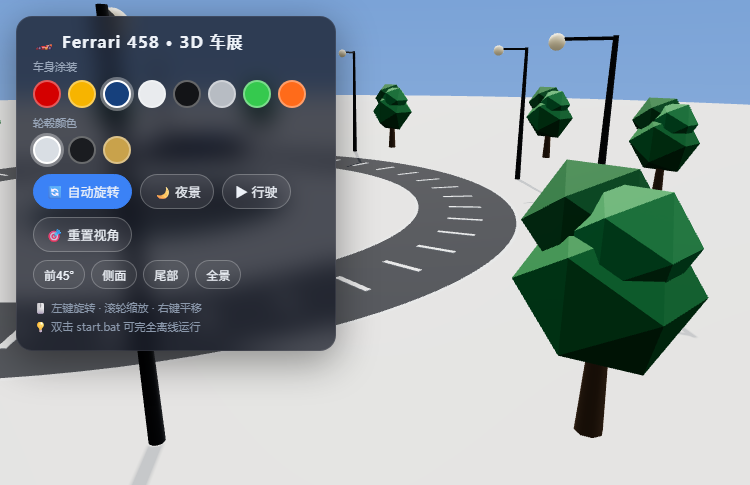

# 🏎️ 3D 跑车展厅 · Ferrari 458

一个基于 **Three.js** 的交互式 3D 车展应用。使用真实高精度的 **Ferrari 458 Italia** 模型（51 个网格部件），配合 PBR 材质、摄影棚级环境反射、动态光影与行驶动画，打造沉浸式看车体验。

**完全离线可用**：模型、引擎、解码器全部打包在项目内，无需外网。



---

## ✨ 功能特性

- **真实车辆模型** — `ferrari.glb` 含 51 个网格 / 58 个节点 / 17 种材质（车身、玻璃、轮毂、轮胎、刹车卡钳、碳纤维内饰、方向盘等），全部重新指派为自定义 PBR 材质
- **8 种车身涂装** — 一键换漆（罗索红 / 竞速黄 / 深海蓝 / 珍珠白 / 曜石黑 / 银灰 / 荧光绿 / 落日橙）
- **3 种轮毂配色** — 亮银 / 曜黑 / 金色
- **PBR 高品质材质** — 清漆车漆（clearcoat）、真玻璃折射（transmission）、镀铬、碳纤维、皮革、橡胶
- **摄影棚级光照** — 环境反射（PMREM + RoomEnvironment）、PCF 软阴影、ACES 电影色调、渐变天空穹顶
- **🌙 夜景模式** — 大灯聚光、尾灯/氛围灯/路灯全亮、环境贴图与雾色同步切换
- **▶ 行驶模式** — 绕半径 8.5 的环形公路跑圈，车轮按真实速度自转、前轮随弯道转向、摄像机平滑跟拍
- **4 个快捷视角** — 前45° / 侧面 / 尾部 / 全景，平滑飞行切换
- **自动旋转** — 车展转台式浏览
- **加载进度与失败回退** — 进度条、错误提示与「重新加载」按钮；本地资源缺失时自动回退 CDN
- **无 WebGL 也能给出明确提示** — 不会白屏，直接提示开启硬件加速

---

## 🚀 快速开始

### 方式一：离线运行（推荐）

需要本机已安装 **[Node.js](https://nodejs.org)**（仅用于启动本地静态服务）。

双击项目里的 **`start.bat`**，浏览器会自动打开 `http://127.0.0.1:8080`，全程不需要联网。

> 如果用不了 `start.bat`，也可以手动在项目目录打开终端执行：
> ```bash
> node server.js          # 默认 8080，被占用时自动尝试 8081~8089
> ```
> 然后访问 `http://127.0.0.1:8080`。
>
> 换端口：`PORT=9000 node server.js`（Windows CMD：`set PORT=9000 && node server.js`）。

### 方式二：直接打开（需联网）

联网状态下直接双击 **`index.html`**（`file://` 协议），页面会自动从 CDN 加载 three.js 与模型。

---

## 🖱️ 操作说明

| 操作 | 效果 |
|---|---|
| 左键拖拽 | 旋转视角 |
| 滚轮 | 缩放 |
| 右键拖拽 | 平移视角 |
| 🔄 自动旋转 | 开关镜头绕车旋转 |
| 🌙 夜景 | 开关夜景灯光 |
| ▶ 行驶 / 🛑 停车 | 启动 / 停止行驶 |
| 🎯 重置视角 | 回到全景视角 |
| 前45° / 侧面 / 尾部 / 全景 | 平滑切换到指定视角 |

---

## 🧪 测试

零依赖、不联网，一条命令跑完：

```bash
node test/run.js
```

`test/run.js` 共 **150 项断言**，分四层：

| 层 | 覆盖内容 |
|---|---|
| `server.js` 纯函数 | URL → 文件路径解析、穿越变体（`../`、`%2e%2e`、`..%5c`、`C:`、空字节、超长 URL）全部拒绝、服务器自身文件/点文件不外泄 |
| 真实 HTTP | 用 `PORT=0` 起一次真服务器（随机端口），验证 200 / MIME（含 `.wasm`）/ HEAD 无响应体 / 403 越权 / 404 无目录列举 / 400 非法 URL / 405 非 GET-HEAD / 413 超大请求体 / 错误响应不泄露绝对路径 |
| 前端纯逻辑 | 把 `index.html` 里的 `<script type="module">` 抽出来用浏览器桩在 Node 里执行，断言涂装表、加载回退计划、尺寸退化、转向/车轮数学、部件→材质映射，以及 WebGL 缺失时给出提示 |
| 真实模型 | 解析 `ferrari.glb` 的 GLB 头与 JSON chunk，核对 51 网格 / 17 材质，并确认每个部件都能映射到自定义材质 |

---

## 📁 目录结构

```
3d-car/
├── index.html          # 入口页面（界面 + 全部前端逻辑）
├── server.js           # 本地静态文件服务器（零依赖，带路径穿越防护）
├── start.bat           # 一键启动脚本
├── test/run.js         # 零依赖测试（node test/run.js）
├── README.md
├── preview.png         # 效果预览图
├── ferrari.glb         # Ferrari 458 车辆模型（1.68MB，DRACO 压缩）
├── vendor/             # three.js 引擎与加载器（本地化，r160）
│   ├── package.json    # 仅声明 type:module，让 Node 工具无警告 import（浏览器不读）
│   ├── three.module.js
│   ├── OrbitControls.js / GLTFLoader.js / DRACOLoader.js / RoomEnvironment.js
│   └── draco/          # DRACO 解码器（draco_decoder.wasm + wasm_wrapper + js 兜底）
└── utils/
    └── BufferGeometryUtils.js   # 仅被 vendor/GLTFLoader.js 引用（toTrianglesDrawMode）
```

---

## 🛠️ 技术栈

- **Three.js r160**（`vendor/three.module.js` 的 `REVISION` 即 `'160'`；ACES 色调映射 + PCF 软阴影）
- **GLTFLoader + DRACOLoader**（`KHR_draco_mesh_compression` 网格压缩解码）
- **MeshPhysicalMaterial**（clearcoat 清漆 / transmission 透射玻璃）
- **PMREM + RoomEnvironment**（HDR 环境反射，烘焙后即释放 PMREM 内部资源）
- 原生 **ES Modules**，零第三方运行时依赖

---

## 🔒 安全说明（`server.js`）

- 只监听 **127.0.0.1**，不对外网暴露；
- 请求路径先 `decodeURIComponent` 再用 `path.relative` 回推，**任何越出项目目录的路径一律 403**（含 `../`、`%2e%2e%2f`、`..%5c`、绝对路径、`C:` 盘符等变体）；
- **不提供目录列举**：目录请求按 404 处理；
- **不提供服务器自身文件**：`server.js` / `start.bat` 与所有点文件（`.git` 等）返回 403，含 Windows 下 `server.js.` 这类结尾点变体；
- 只接受 **GET / HEAD**（其它方法 405），静态资源**不接受请求体**（`Content-Length` 超过 1KB 返回 413），并设置请求头/请求体超时；
- 错误响应只返回状态文本，**不回显内部异常与绝对路径**；所有响应带 `X-Content-Type-Options: nosniff`。

---

## ⚙️ 自定义

### 修改车身颜色

`index.html` 的 `<script type="module">` 顶部（`main()` 之外）有 `PAINTS` 数组，增删条目即可：

```js
const PAINTS = [
  ['罗索红', '#d40000'], ['竞速黄', '#f7b400'], ...,
  ['你喜欢的名字', '#十六进制色值']
];
```

轮毂颜色同理，改同处的 `RIMS` 数组。

### 调整行驶参数

同样是 `main()` 之外的模块级常量：

```js
const DRIVE_R = 8.5;          // 环形公路半径（米）
const DRIVE_MAX_SPEED = 2.4;  // 最高速度
const STEER_MAX = 0.3;        // 前轮最大转向角（弧度）
```

### 更换车辆模型

1. 将新的 `.glb` 文件放到项目目录（默认文件名 `ferrari.glb`，见常量 `LOCAL_GLB`）；
2. 回退地址在 `GLB_REMOTE`；实际尝试顺序由 `buildLoadAttempts()` 生成：
   本地模型 + 本地解码器 → CDN 模型 + 本地解码器 → CDN 模型 + CDN 解码器；
3. 若新模型的部件命名不同，在 `resolveMaterialKey()` 的 `SPECIAL_KEYS` / `MATERIAL_KEYS` 中补充映射（键 → 材质实例的对照表是 `main()` 里的 `MAT_KEYS`）。

### 调试钩子

浏览器控制台可用：

```js
window.__car        // { mode, revision, parts, length, height, wheelRadius, wheels }
window.__carDebug   // 纯逻辑与配置（涂装表、回退计划、材质映射函数…）
__carStats()        // { geometries, textures, programs, calls, triangles } 显存/绘制统计
```

---

## 🖥️ 浏览器兼容

- 建议使用 **Chrome / Edge / Firefox（108+）** 等现代浏览器
- 优先使用 **WebGL2**；浏览器不支持时 Three.js r160 会回退到 WebGL1
- 无法创建 WebGL 上下文时页面会给出明确提示（而不是黑屏）

---

## 📋 常见问题

**Q：页面一直是“正在加载”或提示加载失败？**
- 离线模式请确认是通过 `start.bat`（或 `node server.js`）访问 `http://127.0.0.1:8080`，而不是直接双击 `index.html`；
- 直接双击 `index.html` 时需要联网；
- 若端口被占用，`server.js` 会自动尝试 8081~8089；也可以用 `PORT=9000 node server.js` 指定端口。

**Q：提示“未检测到 Node.js”？**
- 安装 [Node.js](https://nodejs.org)（LTS 版本即可）后重新双击 `start.bat`；或者联网模式直接双击 `index.html`。

**Q：画面是全黑 / 空白？**
- 若遮罩提示“无法创建 WebGL 上下文”，请确认浏览器开启了硬件加速（WebGL 依赖 GPU/软件渲染）。
- 可刷新页面重试；仍不行则更换浏览器。

**Q：怎么确认代码没问题？**
- `node test/run.js`，应输出「通过 150 项，失败 0 项」。

**Q：隐私 / 数据采集？**
- 本项目纯本地运行，不上传任何数据，不依赖外部 API（联网模式仅从 CDN 拉取 three.js 与模型资源）。

---

## 🙏 致谢

- 车辆模型来源：**three.js** 官方示例 `ferrari.glb`（example assets，供学习演示使用）
- 引擎：[three.js](https://threejs.org/)（MIT License）

---

## 📄 License

本项目仅供学习与演示用途，代码可自由参考与修改。请勿将内置车辆模型用于商业发行。
