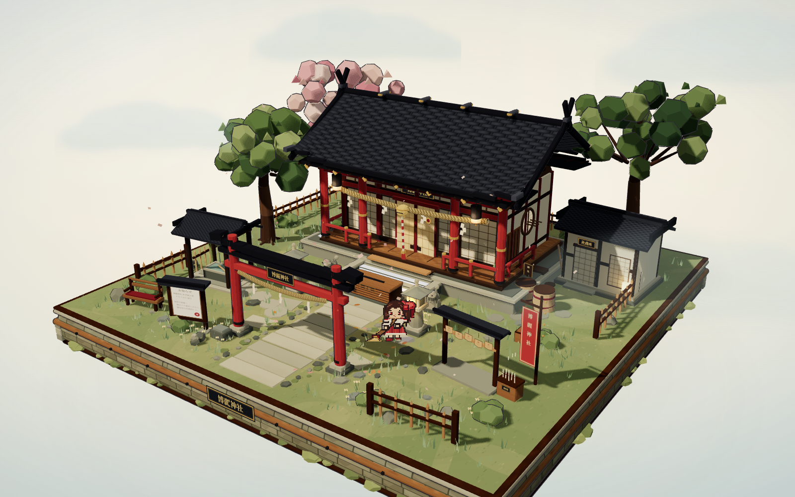
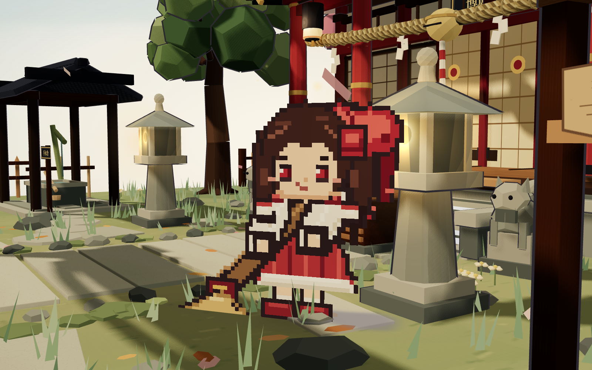

# 博麗神社 · 幻想郷の小さな社

一个使用 **Three.js** 制作的无 UI 三渲二微缩场景：完整的正方形博麗神社庭院，像一件可以拖拽、旋转、缩放欣赏的收藏级立体模型。





## 运行

### 纯 HTML 单文件版

直接双击 **`hakurei-shrine.html`** 即可离线打开。

- Three.js、CSS 与所有程序化贴图均已内联
- 无需安装依赖，无需启动服务器
- 支持电脑与手机浏览器，保留拖拽、缩放、双击复位等交互
- 文件大小约 663 KB

### 源码开发版

Windows 下可直接双击 `run.bat`，或使用命令行：

```bash
pnpm install
pnpm dev
```

打开终端输出的本地地址即可。生产构建：

```bash
pnpm build
pnpm preview
```

## 交互

- 鼠标左键拖拽 / 单指拖动：旋转视角
- 滚轮 / 双指捏合：缩放
- 双击画面：回到默认的三分之四视角

场景没有 HUD、按钮或说明层，只有画面本身。

## 场景内容

- 20 × 20 正方形微缩底座：圆角石砌侧面、木制夹层、木框与铜钉细节，正面有博麗神社铭牌
- 博麗神社本殿：红白柱身、深色曲面大屋顶、千木与坚鱼木、宽檐与椽子、木地板、栏杆、门扉、纸拉门、圆形侧窗、正面台阶
- 注连绳、纸垂、金色神社铃、红白拉绳、赛钱箱与两侧石灯笼
- 鸟居、石阶、石板参道、踏石小径、石砌平台
- 手水舍（含水面与竹制出水口）、绘马架、御神签架、告示牌、社务所、酒桶木箱、长凳、石狮子、围栏、扫帚
- 树木、樱花、灌木、苔藓、草叶、石块、飘落花瓣与落叶
- 缓慢移动的远景薄云与若隐若现的灵性光点

## Q 版像素灵梦

- 依据博丽灵梦的经典人设重绘的 64 × 64 像素图集，共 12 帧（待机、眨眼、扫地、起跳、腾空、落地）
- 深棕色长发、大红色蝴蝶结、红色瞳孔、黄色领巾、白色发饰
- 白色衬衫外搭红色马甲，红裙带白色下摆，白色分离袖配红色缎带，白袜与红鞋
- 使用受光的 `MeshToonMaterial` 平面，面向相机，并带有柔和的轮廓投影
- 每轮扫地后停顿并切换左右扫地方向；完成三轮后小跳到前院另一处空地
- 起跳预备、腾空、落地缓冲；脚底按石板/地面高度自动贴合
- 跳跃时地面影子留在地面，随高度变大、变淡
- 扫地时把附近的落叶或花瓣推向前方
- 呼吸、重心偏移、裙摆与蝴蝶结的轻微律动

> 服饰细节参考了博丽灵梦的通用设定：红色大蝴蝶结、红色眼睛、黄色领巾、白色分离袖、红色裙摆与白发饰。

## 动效

树叶与树冠摇动、草叶随风起伏、绘马与纸垂轻摆、神社铃绳晃动、灯笼微微闪烁、水面纹理缓动、花瓣落叶飘落、薄云漂移、阳光缓慢偏移。

## 技术说明

- Three.js `0.186`
- Vite
- 所有贴图（石板、屋瓦、木纹、和纸、绘马、灯笼、告示牌等）均由 Canvas 程序化生成，无外部图片依赖
- 场景静态网格按材质合并，动态部分（树冠、绘马、纸垂、水流、落叶、粒子等）独立动画，整场景约 370 次绘制调用
- 支持窗口尺寸变化与移动端触控
