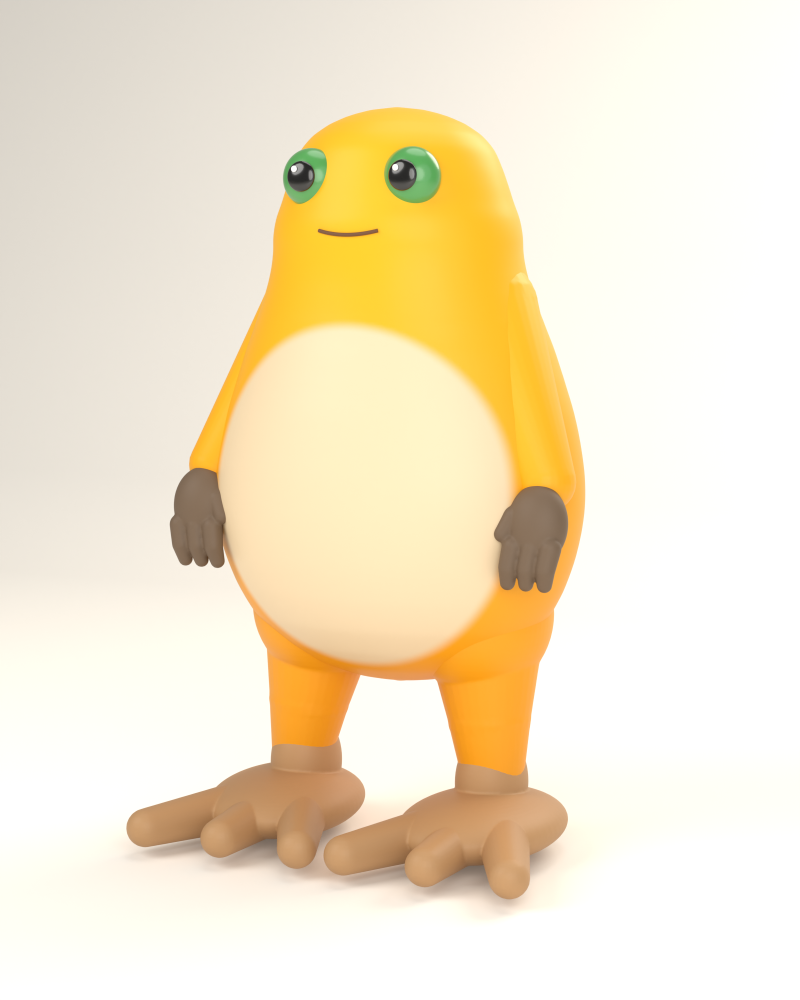
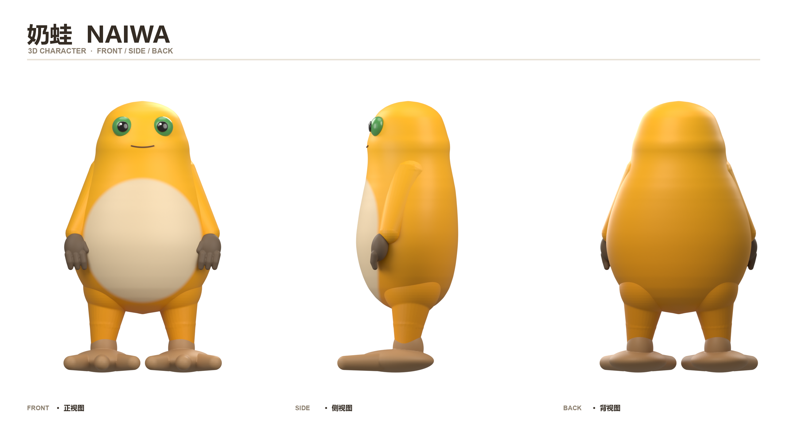

# 奶蛙 NAIWA · 3D 建模

依据用户提供的官方三视图重做的**奶蛙** 3D 形象。  
奶蛙是独立的网络形象，本项目不涉及奶龙。



## 交付内容

| 文件 | 说明 |
| --- | --- |
| [`exports/naiwa.glb`](exports/naiwa.glb) | glTF 2.0 成品，含材质与顶点色，可直接进引擎 / 网页 |
| [`model/naiwa.blend`](model/naiwa.blend) | Blender 4.5 源文件，含摄影棚灯光与相机 |
| [`exports/naiwa_print.stl`](exports/naiwa_print.stl) | 120 mm 高、水密、可直接切片的打印件 |
| [`renders/hero.png`](renders/hero.png) | 1600 × 2000 主视觉 |
| [`renders/model_sheet.png`](renders/model_sheet.png) | 正 / 侧 / 背三视图版式 |
| [`renders/face.png`](renders/face.png) | 面部特写 |
| [`renders/turntable.gif`](renders/turntable.gif) | 360° 转台预览 |

单张三视图：[`front`](renders/front.png) · [`side`](renders/side.png) · [`back`](renders/back.png)



## 造型要点

- **金黄梨形躯干**：窄肩、收腰、大肚，头部与身体连成一体，没有明显脖子。
- **奶白大肚皮**：用顶点色画在躯干表面，不做贴片几何；边缘有柔和过渡，正面看是一块饱满的椭圆，侧面自然收进腹侧。
- **绿色圆眼**：绿色眼球 + 黑色扁瞳孔 + 小白高光，两只眼睛朝正前方。
- **闭嘴微笑**：一条贴合面部曲面的细管，嘴角微微上扬。
- **短肢**：手臂自然下垂，深棕色三指手；腿短而收踝，棕黄色三趾大脚。
- **配色**：金黄 `#F9B60A → #EE9C00` 渐变、奶白 `#E7D0AB`、深棕手 `#6E5B49`、棕黄脚 `#B58D63`。

## 建模方法

全部用 Python 程序化生成，便于改比例和重建：

1. **躯干**：用 Catmull-Rom 曲线定义「高度 → 半径」的梨形轮廓，旋转成封闭曲面；再按高度做 Y 向压扁和前移，得到「前腹饱满、后背收薄」的侧面。
2. **体素重构**：4.5 mm 体素重网格 + 平滑，得到均匀、无接缝的有机曲面。
3. **四肢**：手臂、腿、手、脚各自是独立的光滑体，从肩 / 髋 / 腕 / 踝插入躯干，避免布尔并集在肩肘处产生的褶皱；渲染时同色自然衔接。
4. **肚皮**：读取躯干顶点坐标，按椭圆场 + 前向遮罩写入 `FLOAT_COLOR` 顶点色，导出为 glTF 的 `COLOR_0`。
5. **五官**：眼球为压扁球体，瞳孔为贴在眼球前端的扁球，高光为小白球；微笑线由面部射线投影采样后生成曲线管。
6. **渲染**：Cycles + OptiX，Standard 色彩，柔光棚拍；转台用 EEVEE 渲染 36 帧。

## 规格

| 项目 | 数值 |
| --- | --- |
| 展示尺寸 | 1.30 单位高（约 1.30 m 的玩具比例） |
| 显示网格 | 485,360 顶点 / 970,608 三角面 |
| 打印件 | 69.8 × 53.3 × 120.0 mm |
| 打印网格 | 791,048 三角面，non-manifold 边 0，单一封闭壳体 |
| 材质 | 7 个（黄、绿、黑、白、棕手、棕黄脚、嘴线） |
| 贴图 | 无；颜色来自材质与顶点色 |

> 模型偏高模：脚掌与腿为了圆润的曲面保留了较高密度。若用于移动端，可在引擎里对 GLB 做一次 Decimate（约 0.35）即可降到 30 万面左右。

## 重建 / 重渲染

需要 Blender 4.5+，建议开启 Cycles OptiX。

```powershell
# 1. 重建模型、保存 blend、导出 GLB
blender -b --factory-startup --python scripts/build_naiwa.py

# 2. 主图 / 特写 / 三视图
blender -b model/naiwa.blend --python scripts/render_final.py -- --views hero,face,sheet

# 3. 转台（EEVEE，36 帧）
blender -b model/naiwa.blend --python scripts/render_final.py -- --views turntable

# 4. 合成白底、三视图版式、GIF
python scripts/postprocess.py

# 5. 120 mm 水密 STL
blender -b --factory-startup --python scripts/make_print.py
```

## 目录

```
naiwa-model/
├─ model/naiwa.blend           # 源文件
├─ exports/naiwa.glb           # 展示用 GLB
├─ exports/naiwa_print.stl     # 120 mm 打印件
├─ renders/                    # 成品图 / 三视图 / 转台
├─ refs/                       # 用户提供参考图及局部裁切
└─ scripts/                    # 参数化建模、渲染、后处理、打印
```

## 说明

- 本项目是依据参考图做的同人 3D 练习，非官方出品；参考图的版权归原作者所有，请勿商用。
- 工作目录历经 `新建文件夹` → `naiwa-3d` → `naiwa-model` 的更名（统一为小写 kebab-case）。
- 参考图：[`refs/official_turnaround.png`](refs/official_turnaround.png)（用户提供，仅取上排正版三视图）。
