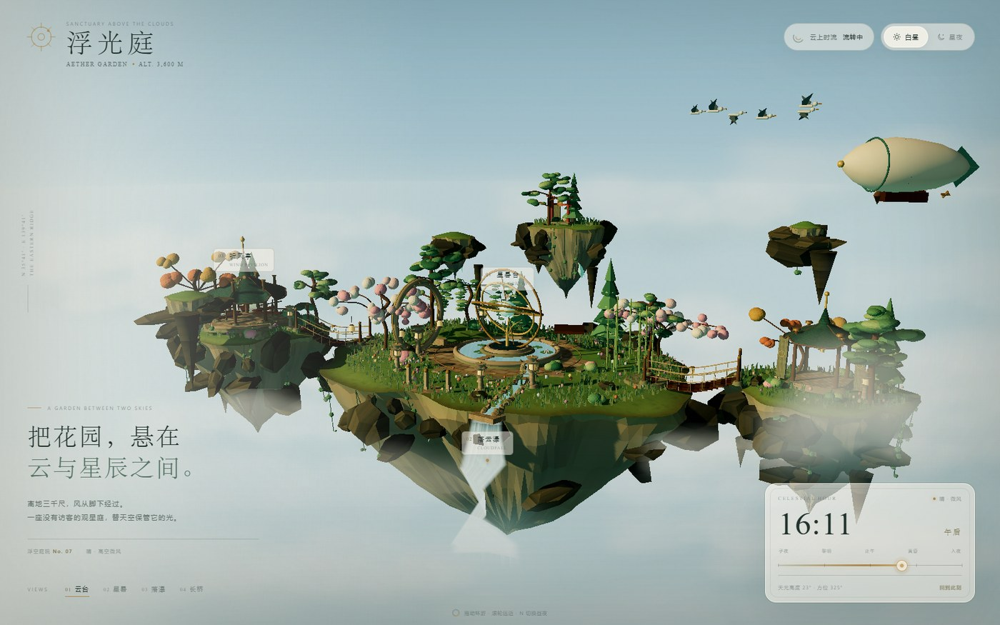
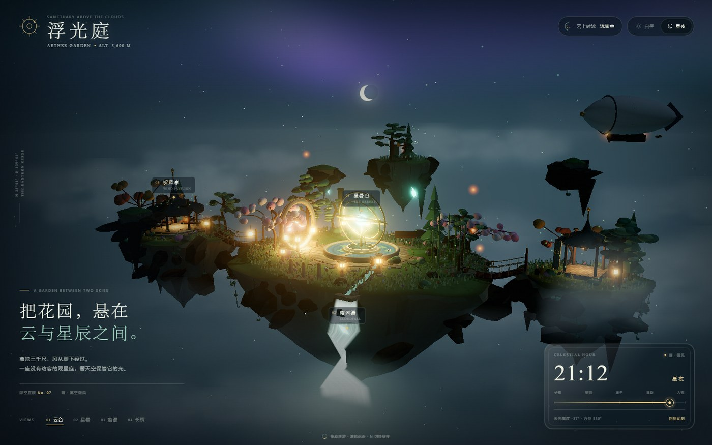
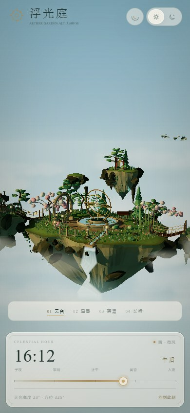

# 浮光庭 · Aether Garden

> 一座悬在云海与星野之间的观星花园。  
> 风从岛屿下方经过，星晷仍在缓慢转动。

<picture>
  <source srcset="docs/preview-night.jpg" media="(prefers-color-scheme: dark)" />
  
</picture>

| 白昼 | 星夜 |
| :---: | :---: |
|  |  |

<p align="center">
  
</p>

## 这是什么

**浮光庭**是一座可自由环绕观赏的 3D 浮空庭院。它由三座主浮岛、一座高处的孤岛、空中石屑、星晷观星台、月洞门、观云亭、风铃祠、瀑布与云桥组成。所有地形、建筑、植物、云层、星图与灯笼纹理都由代码实时生成，不使用外部模型或图片素材。

白昼时它是一座安静的空中花园；入夜后，星星、极光、月牙、萤火与愿灯会依次出现。整个项目最终会打包成一份独立的 `index.html`。

## 直接打开

双击项目根目录中的 **`index.html`**，或直接拖进浏览器即可。

这份文件已经内联全部 CSS、Three.js 与场景脚本，**无需本地服务器，也无需联网**。已在 Edge/Chromium 的 `file://` 环境验证，页面不会发起网络请求。

## 本地开发

需要 Node.js **20.19+**（Vite 8 要求）。

```bash
cd aetherGarden
pnpm install
pnpm dev
# 自动打开 http://localhost:5173/dev.html
```

开发入口是 `dev.html`，支持 Vite 热更新；根目录的 `index.html` 是构建产物。

生产构建会重新生成单文件版本：

```bash
pnpm build
```

它先通过 Vite 打包，再由 `scripts/build-standalone.mjs` 将 CSS 与 JS 内联，覆写根目录 `index.html`，并同时写入 `dist/index.html`。

## 操作

| 操作 | 功能 |
| --- | --- |
| 鼠标拖拽 / 单指拖动 | 环绕观察浮岛 |
| 滚轮 / 双指捏合 | 缩放 |
| 顶部 `白昼 / 星夜` | 在白昼与星夜之间切换 |
| `云上时流` | 开启或暂停 24 小时自动流转 |
| 时间轨道 | 拖动到任意时刻 |
| `回到此刻` | 将场景同步到设备本地时间 |
| `01 云台` `02 星晷` `03 落瀑` `04 长桥` | 切换四个观察视角 |
| 地标标签 | 聚焦星晷台、落云瀑或听风亭 |
| `N` | 切换昼夜 |
| `P` / `Space` | 开关时间流转 |
| `1–4` | 逐一进入四个视角 |
| `Esc` | 中止当前镜头飞行 |

## 场景里有什么

- **浮空岛群**：程序化生成的不规则岛体、倒悬岩壁、岩层、藤蔓、悬石与晶体矿脉；一座更高的浮空孤岛托着红色小神社。
- **星晷台**：水池中央的铜制浑天仪，三层环轨以不同速度旋转，中心晶体在夜间呼吸发光；池面有波纹、莲花与踏石。
- **建筑与路径**：月洞门、木构观云亭、风铃祠、石灯笼、拱石、护栏、绳索云桥、石阶与观景台。
- **四季植物**：云松、樱树、枫树、冷杉、柳树、竹林、灌木、苔石、草本与花丛；花瓣会从樱树冠缓缓飘落。
- **天空系统**：渐变天穹、太阳/月亮方向光、星野、极光、层叠云海、远山浮影与低垂月牙。
- **夜间生命**：萤火虫、升起的愿灯、石缝中的青色晶脉、灯笼与窗光。
- **动态细节**：巡航飞艇、盘旋鹤群、旋转浑天仪、流动瀑布、池水涟漪、漂移云层、风铃与飘落花瓣。

## 实现重点

- **Three.js r187 + Vite 8**，原生 ES Modules。
- 浮空岛顶面使用极坐标网格与高度函数生成，岛底由逐层收缩的岩壁环构成；顶面与倒悬岩壁共用边缘顶点，避免接缝。
- 树叶、云、星图、瓦片、石纹、水面和灯笼使用 Canvas 2D 程序化纹理。
- 天空、极光、星点、月亮和瀑布使用自定义 GLSL；池水包含菲涅尔、日光高光与微波纹。
- 静态建筑、植物、地形细节会在初始化时按材质与几何属性合并，显著减少 draw call；风铃、浑天仪环轨、飞艇、鸟群和粒子保留独立动画。
- 光源、雾、天空、云色、灯笼自发光和水的颜色都随时间连续变化；移动端会限制像素比并拉远镜头，保持完整景观。

## 目录

```text
aetherGarden/
├─ index.html                # 双击即玩的独立单文件
├─ dev.html                  # Vite 开发入口
├─ package.json
├─ vite.config.js
├─ scripts/
│  └─ build-standalone.mjs    # 将 CSS / JS 内联进 index.html
├─ docs/                     # README 预览图
└─ src/
   ├─ main.js                # 渲染循环、时间、镜头与 UI
   ├─ style.css              # HUD、玻璃面板、响应式布局
   ├─ core/
   │  ├─ utils.js
   │  ├─ textures.js         # 程序化 Canvas 纹理
   │  └─ materials.js
   └─ world/
      ├─ index.js            # 场景编排与动态更新
      ├─ environment.js      # 天穹、日月、云海、极光与灯光
      ├─ islands.js          # 浮空岛生成器
      ├─ garden.js           # 星晷台、月门、水池、瀑布、桥梁与路径
      ├─ flora.js            # 云松、樱树、枫树、竹林与地被
      ├─ architecture.js     # 星晷、亭、祠、月洞门与绳桥
      ├─ dynamics.js         # 飞艇、鹤群、萤火、愿灯与花瓣
      ├─ optimize.js         # 静态几何合批
      └─ water.js            # 池水与瀑布 Shader
```

## 备注

- 天气固定为“晴 · 高空微风”；场景时刻与文案会随昼夜变化。
- 若浏览器不支持 WebGL 2，会显示降级说明。
- 推荐把压缩包解压后在独立目录中打开；直接通过 `index.html` 进入时无需安装依赖。

---

**浮光庭** · 云上有庭，庭中有星。
