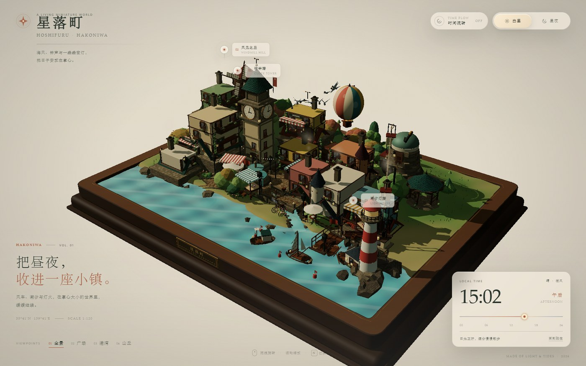
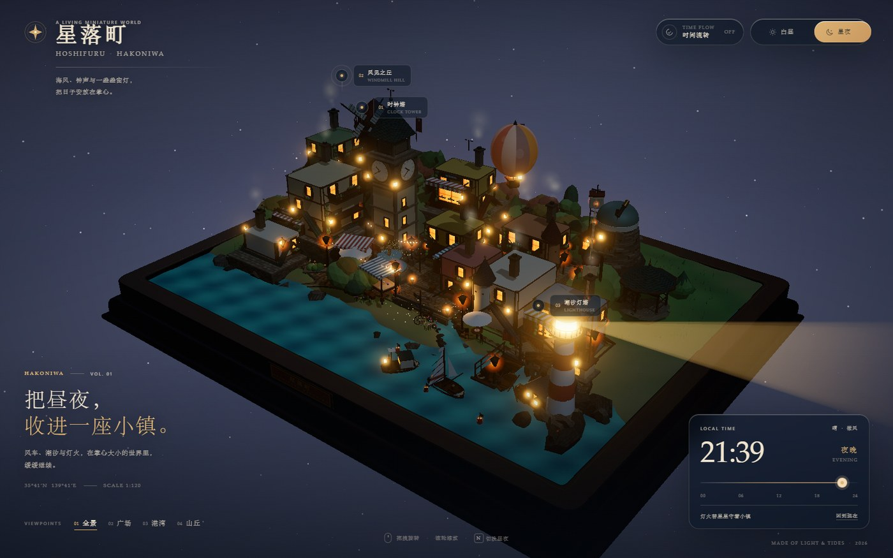
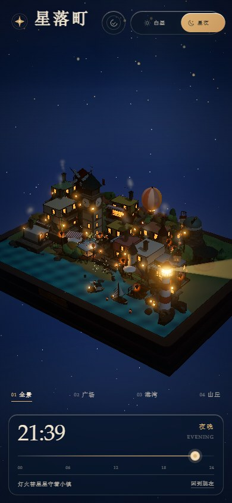

# 星落町 · Hoshifuru Hakoniwa

> 一座盛在胡桃木托盘里的 3D 箱庭小镇。  
> 海风穿过钟塔、风车与缆车，潮汐和灯火把昼夜慢慢推向前。

<picture>
  <source srcset="docs/preview-night.jpg" media="(prefers-color-scheme: dark)" />
  
</picture>

| 白昼 | 星夜 |
| :---: | :---: |
|  |  |

<p align="center">
  
</p>

## 这个项目是什么

**星落町**是一份纯前端的交互式 3D 箱庭作品。所有地形、建筑、树木、船只、招牌纹理与夜空都由代码实时生成，不依赖外部模型或图片素材。你可以围绕小镇旋转、缩放，在四个地标视角间漫游，并拖动时间光轨或切换昼夜，让整座小镇从午后走入灯火通明的星夜。

## 世界里有

- **起伏地形**：带坡度的高地、台地、石阶、挡土墙、河床、海岸线和潮口，避免平铺方块式堆叠。
- **成组建筑**：钟塔、旅店、公会堂、花店、面包房、水车磨坊、林间茶室、海边茶屋、观测站、风车、灯塔与六角凉亭；木构架、山墙、瓦片屋顶、侧窗、凸出阳台、吊牌与花箱均为程序化组合。
- **港湾生活**：木栈桥、吊臂、渔船、可移动帆船、浮标、礁石与沙滩泡沫。
- **完整昼夜**：太阳与月亮方向、天空渐变、星野、云层、窗户灯火、街灯、船灯、壁灯、篝火与灯塔光束连续过渡。
- **动态细节**：转动风车、水车与钟表指针，往返的缆车，巡游热气球，回港帆船，码头浮标，川流的小人、鸟群、炊烟、喷泉、旗帜与飞萤。
- **四季与颜色**：青绿、赭红、秋季橙褐与深松绿交错的植被；不同屋顶、墙面、遮阳篷和店面配色。

## 快速开始

### 方式一：直接打开（无需服务器）

直接双击项目根目录的 **`index.html`**，或拖进浏览器即可。

这份 `index.html` 是内联了全部 CSS、Three.js 与场景脚本的独立文件，**不依赖本地服务器，也不需要联网**。没有任何外部贴图、模型或字体请求。

### 方式二：本地开发

需要 Node.js **20.19+**（Vite 8 要求）。

```bash
cd scenes3d/hoshifuruHakoniwa
pnpm install
pnpm dev
# 会自动打开 http://localhost:5173/dev.html
```

开发入口是 `dev.html`，支持 Vite 热更新。根目录的 `index.html` 是构建产物，不参与开发热更新。

### 重新生成独立版

```bash
pnpm build
```

构建会先由 Vite 打包，再通过 `scripts/build-standalone.mjs` 把 CSS 与 JS 全部内联，覆写根目录的 `index.html`，同时生成可部署的 `dist/index.html`。

也可以使用 npm：`npm install`、`npm run dev`、`npm run build`。

## 操作

| 操作 | 功能 |
| --- | --- |
| 鼠标拖拽 / 单指拖动 | 环绕观察小镇 |
| 滚轮 / 双指捏合 | 缩放 |
| 顶部 `白昼 / 星夜` | 沿时间轴平滑过渡到白天或夜晚 |
| `时间流转` | 开启或暂停自动的 24 小时流动 |
| 时间光轨 | 拖动以手动指定一天中的任意时刻 |
| `回到现在` | 将场景同步到设备本地当前时间 |
| `01–04` / `1–4` 键 | 全景、广场、港湾、山丘视角 |
| 地标标签 | 点击“时钟塔 / 风见之丘 / 潮汐灯塔”快速聚焦 |
| `N` | 切换昼夜 |
| `P` / `Space` | 开关时间流转 |
| `Esc` | 中止当前镜头飞行 |

## 实现说明

- **Three.js r187 + Vite 8**，原生 ES Modules；发布版最终会被内联为单文件 HTML。
- 独立的 `index.html` 不发起网络请求，可直接通过 `file://` 打开；开发时使用 `dev.html` 与 Vite 热更新。
- 地形直接由高度函数采样成自定义 BufferGeometry；河流、港湾与岸边泡沫均为程序化网格。
- 屋顶瓦片、鹅卵石、草地、木纹、钟面、招牌和窗光使用 Canvas 2D 动态绘制为纹理，避免依赖外部资源。
- 水面采用自定义 Shader：波动、菲涅尔、日光高光、夜间水色与天空反射随时间改变。
- 灯塔光束、天空穹顶、萤火虫均为自定义 GLSL。
- 静态建筑/道具会在初始化时按材质合批，减少 draw call；树木保留独立风摆，动态角色、船只、缆车、喷泉等不参与合批。
- 夜景使用低强度 Bloom、窗户自发光与局部点光源形成层次；桌面/移动端分别限制像素比并响应式调整相机 FOV。

## 目录

```text
hoshifuruHakoniwa/
├─ index.html              # 双击即玩的独立单文件构建
├─ dev.html                # Vite 开发入口（热更新）
├─ package.json
├─ vite.config.js
├─ scripts/
│  └─ build-standalone.mjs  # 将 CSS/JS 内联进 index.html
├─ docs/                   # README 预览图
└─ src/
   ├─ main.js              # 渲染循环、相机、时间轴与交互
   ├─ environment.js       # 天空、太阳月亮、云、灯光与材质昼夜响应
   ├─ materials.js         # 材质库
   ├─ textures.js          # Canvas 程序化纹理
   ├─ water.js             # 水面/河流 Shader 与几何
   ├─ style.css            # HUD、玻璃层、响应式版式
   └─ world/
      ├─ index.js          # 场景编排与整体更新
      ├─ terrain.js        # 地形、道路、石桥、瀑布、海岸
      ├─ buildings.js      # 房屋与地标建筑
      ├─ nature.js         # 树木、灌木、花丛、草丛
      ├─ props.js          # 码头、船只、人物、缆车、气球、街具
      ├─ effects.js        # 炊烟、鸟群、萤火虫
      └─ optimize.js       # 静态几何合批
```

## 备注

- 项目中的天气固定为“晴 · 微风”，时间文案与昼夜主题会随场景时刻变化。
- 若浏览器不支持 WebGL 2，页面会显示降级提示。
- 推荐在独立项目中运行，不依赖同级的其他目录。

---

**星落町** · 把昼夜收进一座小镇。
