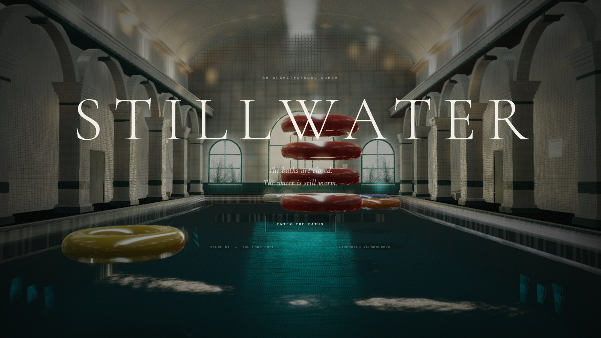
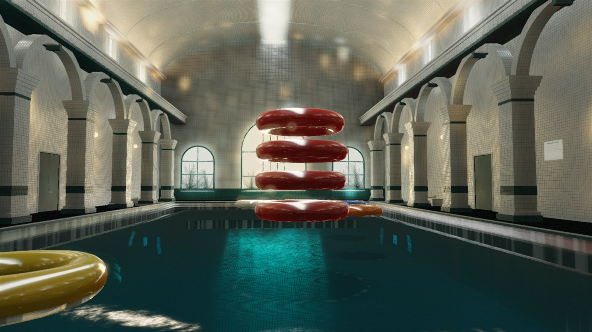
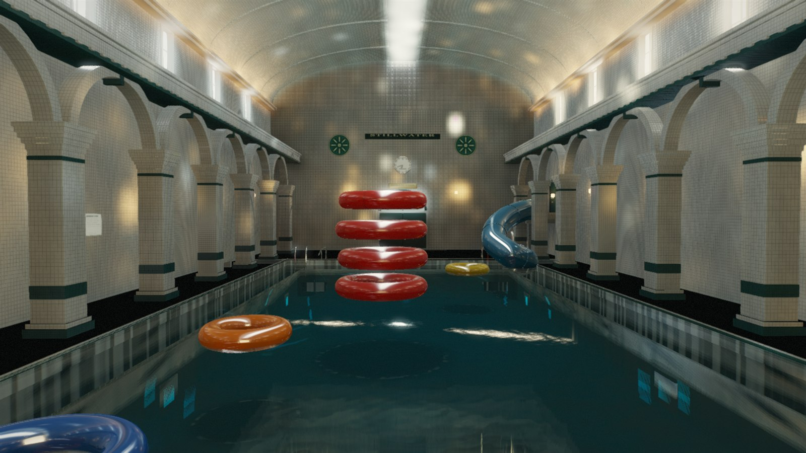
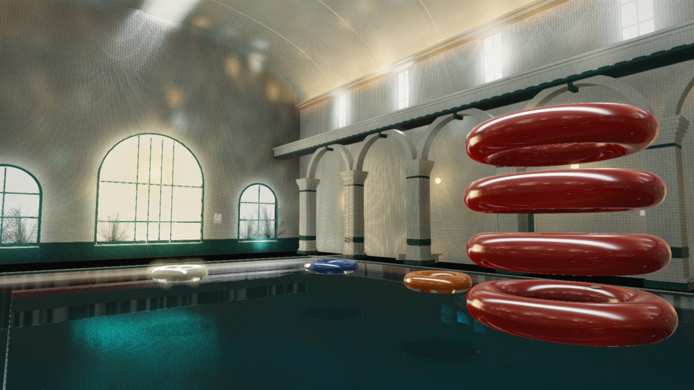
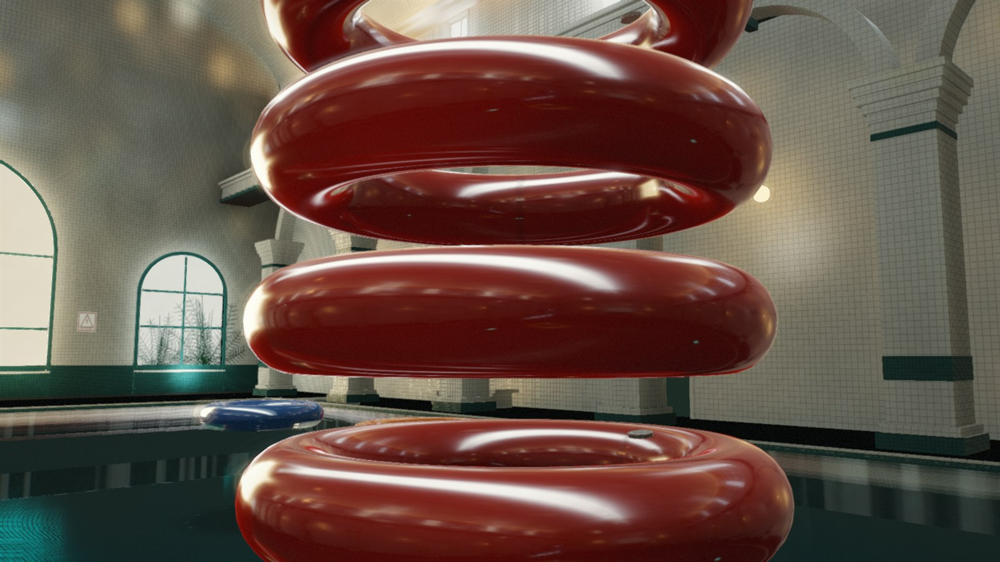

# STILLWATER

> A single-scene, PV/trailer-quality playable architectural demo.
> 一个单场景、PV 质感的室内泳池建筑漫游 Demo。



**STILLWATER** is a liminal municipal bathhouse built as one continuous scene: a long tiled pool, a barrel-vaulted hall, clerestory light, a red inflatable-ring totem, a blue spiral slide, and rings drifting on dark water. It opens with a cinematic flythrough and hands the same camera to you for free drift and photo mode.



| The entrance wall | The arcade |
| --- | --- |
|  |  |



## Quick start

### Windows one-click

Double-click **`start.bat`**. It checks Node.js/npm, installs dependencies on the first run, reuses a demo already running on port 5173, and starts Vite with your default browser. Keep the launcher window open; `Ctrl+C` stops the server. Requires Node.js 20.19+ or 22.12+.

### Manual

```bash
npm install
npm run dev
```

Open `http://127.0.0.1:5173`. A desktop browser with WebGL2 is required. The baked GI volume is included in `public/bake/`, so no bake step is needed to run the demo. On macOS/Linux, use the manual commands above.

## Controls

| Context | Input | Action |
| --- | --- | --- |
| Title | `Enter` / click **ENTER THE BATHS** | Start the film |
| Film | `Esc` / `Space` | Skip the film |
| End card | Click **DRIFT FREELY** | Enter free drift |
| Drift | Click the canvas | Capture the mouse |
| Drift | `WASD` + mouse | Move / look |
| Drift | `Shift` | Move faster |
| Drift | `R` | Replay the film |
| Drift | `P` | Photo mode |
| Drift | `M` | Toggle sound |
| Photo | `↑` / `↓` | Exposure |
| Photo | `[` / `]` | Focal length |
| Photo | `S` | Save a PNG frame |
| Photo | `P` | Exit photo mode |

The HUD lists the same bindings in-scene. Audio is procedural WebAudio; headphones are recommended.

## What is rendered

- **One continuous space.** A 24 m × 52 m hall with a long pool, tiled decks, arcade colonnades, arched windows, an entrance wall with frieze / clock / enamel medallions, a barrel-vault skylight, and a vestibule beyond the far glazing.
- **Ceramic tile.** A custom tile shader reconstructs the geometric normal and grout from world-space tiles, then applies a single broad rect-light specular lobe, a softer environment reflection, and baked GI. The tile field has no per-tile glitter; reflections stay smooth and ceramic.
- **Water.** A fullscreen water composite with depth-based absorption, refracted scene color, planar reflection, Fresnel, surface glints, drifting Voronoi caustics, and restrained shoreline / contact foam. The pool bottom, submerged steps, and blue underwater lights remain readable through the dark teal volume.
- **Baked light.** A 3D GI volume (72 × 48 × 112, RGBA16F, 160 spp, 4 bounces) is baked offline, denoised, and sampled in the tile, paint, and water shaders. Analytical rect lights, sconces, cove strips, and the far glazing carry the direct light and speculars.
- **Air and light.** An analytical atmosphere adds depth fog, the barrel-vault beam, angled clerestory shafts, and soft bloom. The final pass adds filmic tonemapping, FXAA, grain, and vignette.
- **Procedural detail.** All geometry, decals, foliage silhouettes, signage, and the sun are generated in code. No external models or textures are used; the only downloaded assets are the two font families.

## Rendering pipeline

`src/render/post.ts` and `src/shaders/post.ts` implement a custom HDR forward pipeline:

1. Render the scene to an HDR target with planar reflection, GI, direct lights, and environment.
2. Composite the water from the scene color and reflection target.
3. Apply the atmosphere / light-shaft pass.
4. Bloom, filmic tonemap, FXAA, grain, and vignette in the final pass.

The environment cubemap is captured from the hall center after the GI volume is applied, so chrome, plastic, and glazed surfaces pick up the room's actual color.

## Project layout

```text
start.bat                  Windows one-click launcher
index.html                 DOM UI: title, film, HUD, photo mode, end card
src/main.ts                app bootstrap, modes, input, timeline
src/style.css              UI and typography
src/scene/                 procedural world, geometry builders, lights, constants
src/shaders/               tile/paint/metal/plastic/slide/emissive GLSL
src/render/                material library, post pipeline, environment, bake loader
src/game/                  cinematic camera, drift controller, procedural audio
scripts/                   bake drivers, screenshot and UI validation harnesses
public/bake/gi.bin|json    active baked GI volume
preview/                   curated stills used in this README
references/                mood-board images (inspiration only)
```

## Screenshots and validation

With a dev server running on port 5173:

```bash
npm run shots:final   # 7 views, DPR 2, output in shots/final/
npm run ui            # title, film, end card, HUD, photo, mute
npm run ui:controls   # film replay, photo exposure / lens, label restore
```

`npm run shots` accepts named views (`hero`, `low`, `arcade`, `far`, `back`, `entrance`, `rings`) and the options `--dpr=2 --out=shots/final`. The screenshot harness starts Vite itself if port 5173 is free.

## Baking

The included volume is the high-quality bake. Re-bake only if you change the geometry, material emitters, or light layout:

```bash
npm run bake:parallel -- --dims=72x48x112 --spp=160 --bounces=4 --workers=24 --out=gi
```

This splits the volume into Z slices, renders them in parallel child processes, merges and denoises the result, and writes `public/bake/gi.json` and `public/bake/gi.bin`. The reference bake took about 12 minutes on 24 workers on an RTX 4070 Laptop. For a fast single-process preview:

```bash
npm run bake -- --preview
```

The runtime always reads `public/bake/gi.json` and `gi.bin`. The loader expects RGBA16F half-float radiance with `alpha = 1`.

## Build

```bash
npm run build
npm run preview   # http://127.0.0.1:4173
```

The production build copies the GI volume from `public/bake/`. Vite reports a chunk-size warning for the Three.js bundle; it is expected and not an error.

## Notes

- Target: desktop WebGL2, high-DPI. Tested on Edge headless with an RTX 4070 Laptop at 1600 × 900, with DPR-2 captures at 3200 × 1800.
- There is no runtime scene streaming: the whole bathhouse is one scene, and the only asynchronous load is the GI volume.
- The four images in `references/` are mood/inspiration only and are not part of the rendered assets.
- Built as a playable look-development / PV prototype, not a shipping game. No save data, networking, or mobile layout.

## Credits

Three.js · Vite · TypeScript · Playwright · Fontsource (Cormorant Garamond, IBM Plex Mono).
