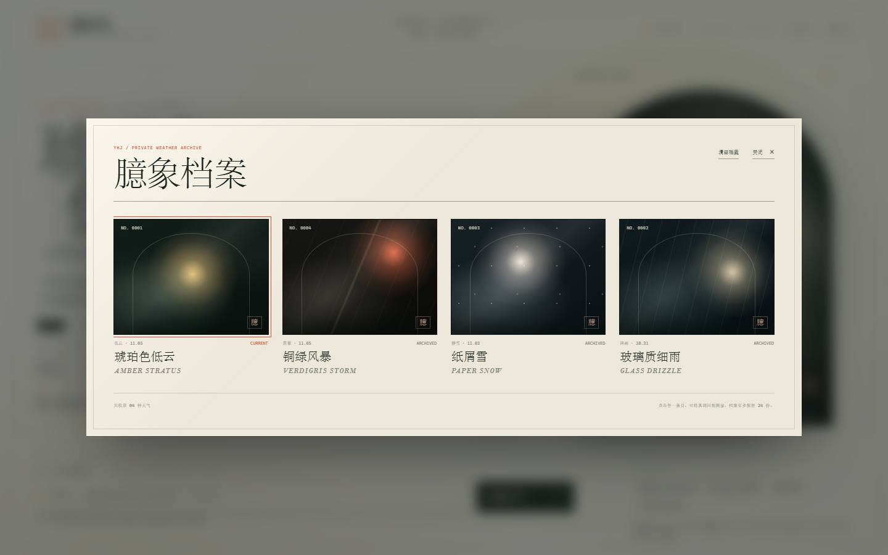

# 臆候局 · The Bureau of Imagined Weather

> 为尚未发生、却已被感受的天气，建立一份非官方档案。

**臆候局**是一个虚构的气象机构，也是一件可以直接在浏览器里体验的生成式数字装置。你交出一段感受，它从七个气候家族中推断出一场天气，并生成独属于这一刻的名称、云图、读数、体感与一段简短的观察记录。


## 怎么玩

1. 在页面底部写下一段感受，比如「凌晨三点的便利店」「没说出口的再见」，也可以直接点击推荐样本。
2. 点击 **铸造天气**。描述中的关键词会决定它更接近雾、雨、雪、雷暴、光晕、风还是余烬。
3. 观察窗里会长出一场天气。**轻触玻璃**可以扰动它；打开 **声场**，还能听见由 Web Audio 实时合成的空气、雨声与和声。
4. 每次生成的天气会自动进入 **臆象档案**，最多保留 24 份。点击旧档案可以随时把它调回观测窗。
5. 点击 **导出标本卡**，会得到一张 1200 × 1600 的 PNG 收藏卡。



## 启动

项目没有任何运行时依赖，也不需要构建。需要 Node.js 18+：

```bash
npm start
```

然后打开 <http://127.0.0.1:4173>。

也可以使用 Python 起一个静态服务器：

```bash
python -m http.server 4173
```

或者直接双击 `index.html`。为了获得稳定的 localStorage 行为，仍建议通过本地服务器访问。

## 项目结构

```text
.
├── index.html          页面结构与文案
├── styles.css          编辑式视觉系统、档案馆与响应式布局
├── data.js             七类气候语汇、名称、读数范围与音色参数
├── weather.js          Canvas 2D 臆象天气引擎 + Web Audio 声场
├── app.js              天气生成、档案持久化、交互与 PNG 导出
├── server.mjs          零依赖静态服务器
├── assets/             README 预览图
└── package.json
```

## 一些设计说明

- **一场天气，从一段感受开始。** 系统用一组轻量关键词规则推断气候家族；名称、描述、体感、读数、坐标与配色则在此后展开。它不是真实的天气预报，而是一套把情绪翻译成气象的写作机器。
- **每一类气候有独立的 Canvas 语法。** 雾用多层云絮与横向雾丝；雨用玻璃质雨线与落地涟漪；雪有六向晶体；雷暴有随机分叉闪电；光晕有缓慢旋转的射线；风有流场轨迹与蒲公英种子；余烬有上升的微粒。云层由离屏径向渐变、屏幕混合与缓慢漂浮的粒子共同生成。
- **声场也是生成的。** 不使用任何音频素材；环境噪声、滤波器、调音与钟声都由 Web Audio 实时合成，并随气候家族与随机种子变化。
- **可触摸的档案。** 生成的天气会被写入 localStorage；页面刷新后仍能回到最近一次观测。所有内容都只留在当前浏览器里。
- **为纸而设计。** 字形混合了宋体、Bodoni 与等宽标注；观测窗、标尺、坐标和并不存在的机构编号，共同组成一份介于科学记录与小说之间的印刷品。
- **减少动态。** 页面尊重 `prefers-reduced-motion`；开启后转场和粒子速度会降低。

## 技术

- 原生 HTML / CSS / JavaScript，无框架、无网络请求、无字体 CDN。
- Canvas 2D + ResizeObserver + requestAnimationFrame。
- Web Audio API 实时声景。
- localStorage 本地档案。
- Canvas 合成并下载 PNG 标本卡。
- CSS clamp / grid / 响应式断点，桌面、平板与手机布局。

## 说明

臆候局并不存在。本局不受理真实天气，也不对任何一次想起负责。页面生成的文字来自一份预先写好的小型天气语汇，所有天气、地点与读数均为虚构。
